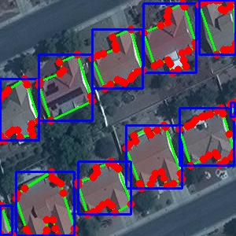
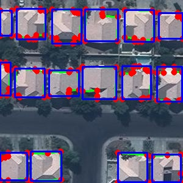

PEVFormer is introduced in the paper **Polygon Edge and Vertex-Aware Transformer for Building Contour Extraction from Remote Sensing Images**. A paper link is not available yet.

[Project repository](https://github.com/entropia-lw/PEVFormer)

PEVFormer extracts building polygons from remote sensing images. This repository provides pretrained inference and evaluation for small and medium buildings, using images and building proposals as inputs.

## 1. Environment setup

### 1.1 Reference environment

The original cloud environment used:

| Component | Version or configuration |
|---|---|
| Operating system | Ubuntu 18.04 |
| Python | 3.8 |
| PyTorch | 1.9.0 + CUDA 11.1 |
| torchvision | 0.10.0 + CUDA 11.1 |
| Detectron2 | 0.6 |
| GPU | RTX 3090, 24 GB |

### 1.2 Get the code

```bash
git clone https://github.com/entropia-lw/PEVFormer.git
cd PEVFormer
export PYTHONPATH="$PWD${PYTHONPATH:+:$PYTHONPATH}"
```

### 1.3 Create an environment and install dependencies

```bash
conda create -n pevformer python=3.8
conda activate pevformer

python -m pip install torch==1.9.0+cu111 torchvision==0.10.0+cu111 \
  -f https://download.pytorch.org/whl/torch_stable.html
```

Detectron2 must match the PyTorch and CUDA versions. See the [official installation instructions](https://detectron2.readthedocs.io/en/latest/tutorials/install.html). For the Linux combination above:

```bash
python -m pip install detectron2==0.6 \
  -f https://dl.fbaipublicfiles.com/detectron2/wheels/cu111/torch1.9/index.html
```

Install the remaining inference dependencies:

```bash
python -m pip install -r requirements.txt
```

To evaluate existing prediction JSON files only, use `requirements-eval.txt`. That workflow does not load the model or require a GPU; these dependencies do not replace the inference environment.

### 1.4 Build deformable attention

Run from the repository root. A compatible CUDA Toolkit and compiler are required.

```bash
cd pevformer/ops
sh make.sh
cd ../..
```

Check the dependencies and GPU:

```bash
python -c "import torch, detectron2, MultiScaleDeformableAttention; print(torch.__version__); print(torch.cuda.is_available())"
```

The inference package is named `pevformer`. Use the matching configuration and checkpoint without converting checkpoint keys.

## 2. Data preparation

The CrowdAI dataset is too large to include in this GitHub repository. **For downloading and processing both the training and validation sets, follow the corresponding README files in the [RoIPoly data/crowdai directory](https://github.com/HeinzJiao/RoIPoly/tree/main/data/crowdai).** Follow the instructions for each split and the applicable dataset terms.

**Acquisition and preparation of all accompanying input annotations, including cleaned ground-truth polygons and small/medium building proposals, follow RoIPoly.**

### 2.1 Required inputs

- Validation images.
- Cleaned ground-truth polygon annotations for AP/AR evaluation.
- Small/medium building proposals generated by Sparse R-CNN with a Swin-B backbone.

Keep ground truth and detection proposals separate. Preserve image IDs and file names, and follow the upstream small/medium proposal split. Detection-box area and ground-truth polygon area serve different purposes in data preparation.

### 2.2 Directory layout

The commands below assume:

```text
PEVFormer/
├── data/
│   └── crowdai/
│       └── val/
│           ├── images/
│           │   ├── 000000000000.jpg
│           │   └── ...
│           ├── annotation_clean.json
│           └── annotation_sparsercnn_swinb_1930059_sm.json
├── configs/
├── pevformer/
├── scripts/
└── weights/
```

Input files:

- `annotation_clean.json`: ground-truth polygons supplied to the evaluation script.
- `annotation_sparsercnn_swinb_1930059_sm.json`: small/medium detection proposals supplied to the inference script.
- `images/`: original validation images.

## 3. Pretrained checkpoint

Small and medium building model:

- Checkpoint: `weights/model_2842654.pth`.
- Configuration: `configs/pevformer.res50.crowdai.sm.yaml`.
- Download: [Baidu Netdisk](https://pan.baidu.com/s/1agDdELFJqCo6OJaB61QFlw?pwd=aa9g).
- Access code: `aa9g`.

The checkpoint is distributed separately and is not included in Git commits.

Place the downloaded checkpoint at:

```text
weights/
└── model_2842654.pth
```

Use the checkpoint matching this release. The inference entry point loads the entire model strictly and reports missing keys or shape mismatches instead of silently skipping them.

Provided proposal annotations can be used without rerunning the detector. To generate proposals for custom images, prepare the Sparse R-CNN (Swin-B) configuration, checkpoint, and inference environment separately. The detector package is not included in this release.

## 4. Polygon inference

Use the ResNet-50 small/medium configuration and the matching checkpoint.

Run from the repository root with a new output directory:

```bash
RUN_DIR="outputs/sm_$(date +%Y%m%d_%H%M%S)"
mkdir -p "$RUN_DIR"

set -o pipefail
CUDA_VISIBLE_DEVICES=0 python scripts/evaluate_change.py \
  --config-file configs/pevformer.res50.crowdai.sm.yaml \
  --output "$RUN_DIR" \
  --iter 2842654 \
  --corner-threshold 0.4 \
  --train-json data/crowdai/val/annotation_sparsercnn_swinb_1930059_sm.json \
  --train-path data/crowdai/val/images \
  --opts MODEL.WEIGHTS weights/model_2842654.pth \
  2>&1 | tee "$RUN_DIR/inference.log"
```

The `--iter` argument labels the output file. With 2842654, inference produces:

```text
outputs/<run-directory>/
├── predictions_2842654.json
└── inference.log
```

The JSON contains image IDs, categories, confidence scores, bounding boxes, and polygon coordinates. The example uses a corner threshold of 0.4 and keeps polygons with at least three vertices and an area of at least 10.

If you change `--iter`, update the prediction file path in the evaluation command accordingly. The inference entry point exports JSON; it does not generate new visualization images.

## 5. COCO Segmentation evaluation

Evaluate newly generated predictions against ground-truth polygons.

```bash
python scripts/evaluation.py \
  --gt-file data/crowdai/val/annotation_clean.json \
  --dt-file "$RUN_DIR/predictions_2842654.json" \
  --eval-type coco_iou \
  --output "$RUN_DIR" \
  2>&1 | tee "$RUN_DIR/evaluation.log"
```

The output statistics file is:

```text
test.stats.predictions_2842654.json
```

## 6. Results and visualizations

The building extraction results of PEVFormer are shown in the following two images.





## 7. Acknowledgements

This project is based on [RoIPoly](https://github.com/HeinzJiao/RoIPoly) and benefits from the public implementations of [Sparse R-CNN](https://github.com/PeizeSun/SparseR-CNN), [Deformable DETR](https://github.com/fundamentalvision/Deformable-DETR), and [RoomFormer](https://github.com/ywyue/RoomFormer). We thank their authors for sharing their work.

## 8. License

**This section is a draft. The final project license will be determined by the root LICENSE file once confirmed, together with applicable third-party licenses.**

For project code that the authors are entitled to license, the intended license follows RoIPoly: [Creative Commons Attribution-NonCommercial-ShareAlike 4.0 International (CC BY-NC-SA 4.0)](https://creativecommons.org/licenses/by-nc-sa/4.0/).

- Retain appropriate attribution, a license link, and an indication of changes when using, modifying, or redistributing the material.
- Material covered by this license must not be used for commercial purposes.
- Redistributed adaptations must follow the ShareAlike requirements.
- The software is provided as is, without warranties.

Third-party components retain their own licenses and copyright notices. This section does not replace or override their terms. Conditions for pretrained checkpoints and datasets will be specified in their download information.
